<div align="center">

# 🏠 Robust Regression Engine

### Predicting house prices that actually hold up on new data

*Regularization · Cross-Validation · Tree Models · Support Vector Regression · Streamlit*


**[🚀 Live App](https://robust-regression-engine-bacwdre2fkjonguvkecdse.streamlit.app/#robust-regression-engine)** &nbsp;|&nbsp; **[🎥 Video Explanation](https://drive.google.com/drive/folders/1pbV8M0-k7Npzu5pNcS225bKc2e65EK2T)** &nbsp;|&nbsp; **[📓 Notebook](Robust_Regression_Engine.ipynb)** &nbsp;|&nbsp; **[📄 Theory (PDF)](Robust_Regression_Engine_Theory.pdf)**

</div>

---

## 👋 About this project

Hi, I'm **Bhavy**. This is my Supervised Learning project.

The story is simple. A real estate company already had a basic model to predict house prices, but it **overfitted** and gave **unstable predictions** whenever the data changed. 

- ✅ uses **regularization** to control overfitting,
- ✅ uses **proper cross-validation** to test the model fairly,
- ✅ compares **linear and non-linear** models,
- ✅ picks the **best model** using validation performance, not just training score.

I tried 7 models, tuned all of them with cross-validation, and the winner was **SVR with the RBF kernel** (test R² = **0.936**). I also turned it into a small Streamlit app where anyone can enter property details and get a price.

---

## 📊 The dataset

3,800 properties sold between **2010 and 2023**. No missing values.

| Group | Columns |
|---|---|
| Size & structure | `area_sqft`, `bedrooms`, `bathrooms` |
| Location | `location_score`, `distance_city_km`, `near_school`, `near_metro`, `crime_rate_index` |
| Age & time | `property_age`, `sale_date` (I made `sale_year` from it) |
| **Target** | `house_price_inr` (I used **Lakh INR** to keep numbers readable) |

I dropped `property_id` because it is only an identifier. Split: **80% train (3,040 rows) / 20% test (760 rows)**.

Price is right-skewed, and area and location score show the strongest link with price:

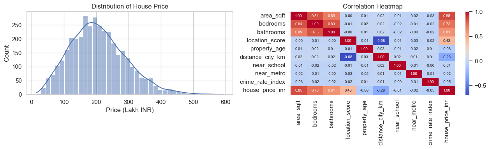

---

## 🧭 How the project is organised

| Part | Questions | What I did |
|---|---|---|
| **A** | 1 – 5 | Theory: regularization, Ridge vs Lasso, cross-validation, 4 CV types, why trees don't need scaling |
| **B** | 6 – 8 | Features and target, train–test split, scaling inside a Pipeline |
| **C** | 9 – 12 | Ridge and Lasso, tuning alpha with CV, comparing them |
| **D** | 13 – 14 | K-Fold, Stratified K-Fold, LOOCV, Time Series Split |
| **E** | 15 – 18 | Decision Tree, controlling its complexity, Random Forest |
| **F** | 19 – 21 | SVR (linear and RBF), tuning C, gamma, epsilon |
| **G** | 22 – 24 | MSE / MAE / RMSE / R², group comparison, over/underfitting check |
| **H** | 25 – 26 | Final report, saved model, Streamlit app |

---

## 🔬 What I found (with outputs)

### Part B · Preprocessing without data leakage
Ridge, Lasso and SVR need scaled features, trees don't. I put `StandardScaler` **inside a Pipeline**, so during cross-validation it learns only from the training folds.

### Part C · Ridge and Lasso
I tuned `alpha` with 5-fold CV over 30 values (0.001 → 1000). Too high and the model underfits, too low and it behaves like plain linear regression.

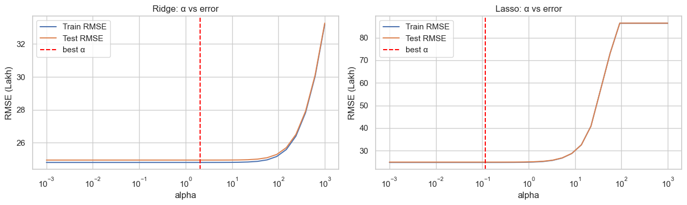

| Model | Best alpha | Train RMSE | Validation RMSE | Test RMSE |
|---|---|---|---|---|
| Ridge (L2) | 2.0434 | 24.8247 | 24.9512 | 25.3965 |
| Lasso (L1) | 0.1172 | 24.8266 | 24.9493 | 25.4201 |

Honest observation: Ridge and Lasso are almost the same as plain linear regression here, because the dataset is big and has only 10 features. `area_sqft` (≈ 69.5) and `location_score` (≈ 36.8) dominate the coefficients, and Lasso didn't zero out any feature, it only shrank the weak ones like `near_school`.

| Coefficients | Coefficient paths |
|---|---|
| 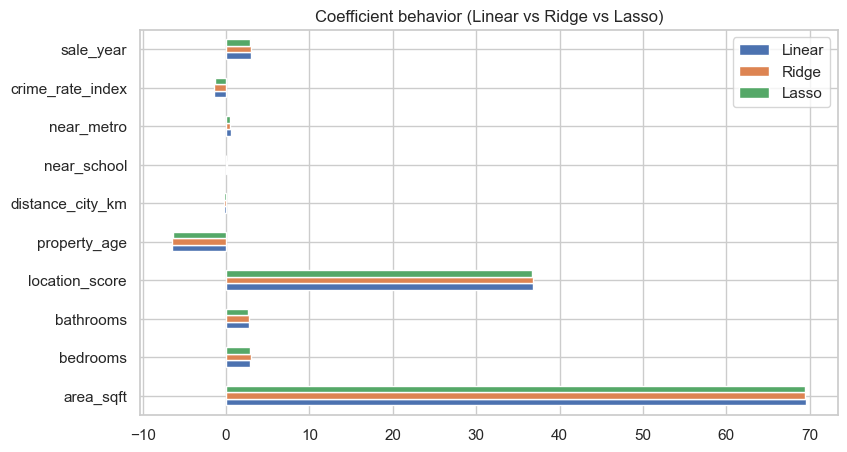 | 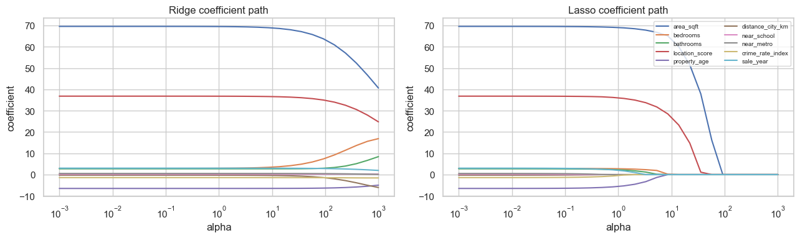 |

### Part D · Cross-validation strategies
I ran the tuned Ridge model through four different CV techniques:

| Strategy | Folds | RMSE | RMSE std | MAE | R² |
|---|---|---|---|---|---|
| K-Fold (k=5) | 5 | 24.951 | 0.890 | 19.066 | 0.9163 |
| Stratified K-Fold (binned target) | 5 | 24.899 | 0.788 | 19.032 | 0.9168 |
| Time Series Split (by sale_year) | 5 | 24.850 | 0.919 | 18.948 | 0.9167 |
| Leave-One-Out (LOOCV) | 3040 | 24.923 | – | 19.039 | 0.9167 |

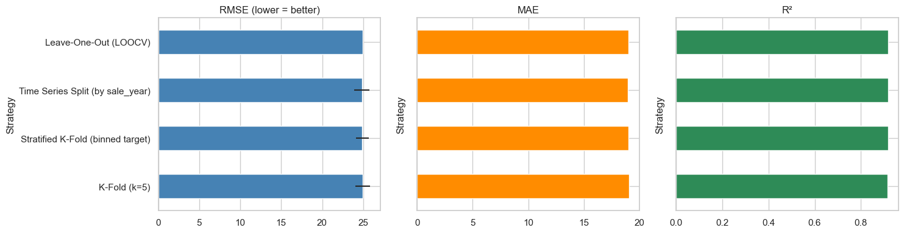

All four agree (RMSE between 24.85 and 24.95), so the estimate is stable. I use 5-fold CV for tuning and the Time Series Split as an extra safety check.

### Part E · Trees
An unpruned decision tree **memorized** the training set: train R² = 1.00 but test R² = 0.869. After limiting `max_depth` (best = 8) and `min_samples_leaf` (best = 20), the test R² went up to 0.907. A Random Forest did even better.

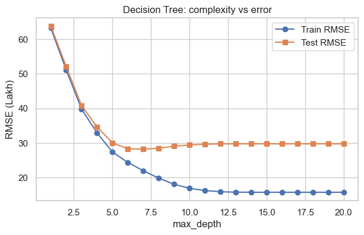

| Model | Train RMSE | Test RMSE | Train R² | Test R² |
|---|---|---|---|---|
| Decision Tree (unpruned) | 0.0000 | 32.4529 | 1.0000 | 0.8692 |
| Decision Tree (tuned) | 22.9116 | 27.3488 | 0.9296 | 0.9071 |
| Random Forest (tuned) | 13.6275 | 23.8732 | 0.9751 | 0.9292 |

| Random Forest feature importance | Tree vs Forest predictions |
|---|---|
| 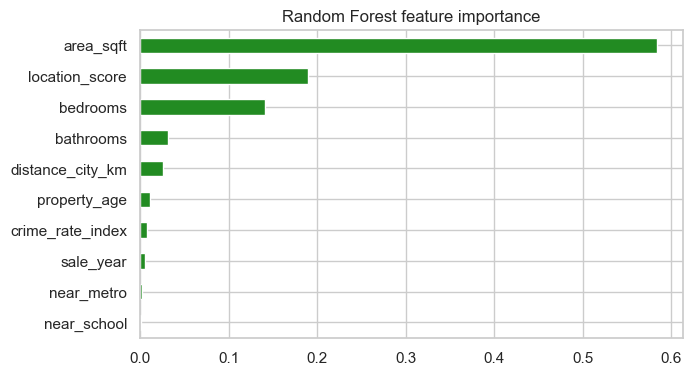 | 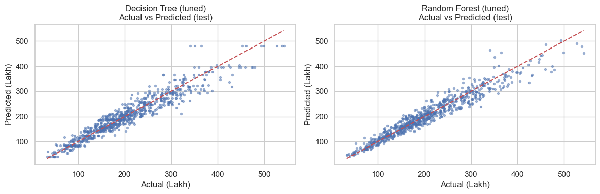 |

### Part F · Support Vector Regression
I scaled both the features **and** the target so `C` and `epsilon` make sense. Best settings:

- **Linear kernel:** C = 1, epsilon = 0.2 → CV RMSE 24.96
- **RBF kernel:** C = 1, gamma = 0.03, epsilon = 0.05 → CV RMSE **22.68** 🏆

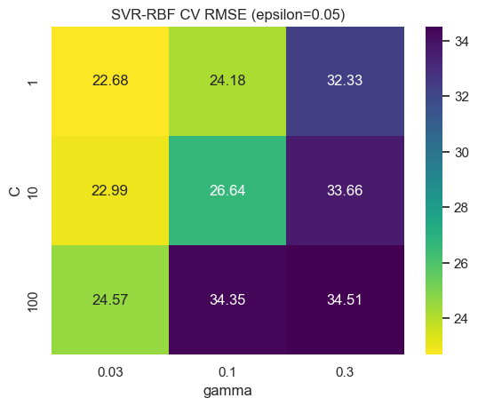

### Part G · All models, side by side

| Model | Test RMSE | Test MAE | Test R² | CV RMSE |
|---|---|---|---|---|
| Linear Regression (baseline) | 25.3915 | 19.4488 | 0.9199 | 24.9514 |
| Ridge (L2) | 25.3965 | 19.4463 | 0.9199 | 24.9512 |
| Lasso (L1) | 25.4201 | 19.4611 | 0.9198 | 24.9493 |
| Decision Tree (tuned) | 27.3488 | 20.2227 | 0.9071 | 27.3312 |
| Random Forest (tuned) | 23.8732 | 17.5312 | 0.9292 | 23.5698 |
| SVR Linear (tuned) | 25.5235 | 19.4472 | 0.9191 | 24.9585 |
| **SVR RBF (tuned)** | **22.7372** | **16.6468** | **0.9358** | **22.6845** |

*(All errors are in Lakh INR. Lower RMSE/MAE is better, higher R² is better.)*

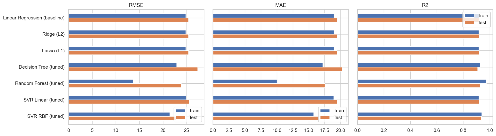

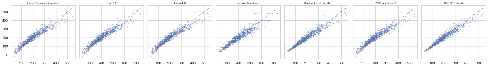

**Over/underfitting check:** the unpruned tree is the clear overfit. Random Forest has the biggest gap among tuned models (train 0.975 vs test 0.929, mild overfit). **SVR RBF has a gap of only 0.003**, which is the best balance.

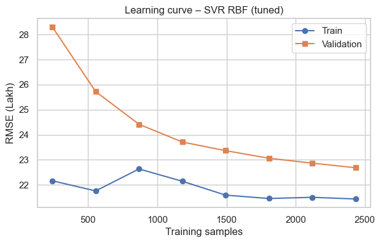

---

## 🏆 Final result

> **Best model: SVR (RBF kernel)**
> Test RMSE **22.74 Lakh** · MAE **16.65 Lakh** · R² **0.936**

- **Regularization:** gave stable coefficients, but little accuracy gain on this dataset. The bigger win was pruning the tree (test R² 0.869 → 0.907).
- **Cross-validation:** helped me tune everything without touching the test set, and all four CV strategies gave almost the same score.
- **Linear vs non-linear:** the best non-linear model (SVR RBF, RMSE 22.74) beat the best linear one (Ridge, RMSE 25.40), so house prices clearly have non-linear behaviour.
- **Business meaning:** the typical error is about **₹16.6 lakh (~8%)** of the average price (~₹2.05 crore), and the model explains **93.6%** of price variation. Area and location score are the biggest price drivers.

---

## 🖥️ Streamlit app

I saved the best model as `final_model.joblib` and built `app.py`. You enter the property details and it shows the predicted price with a likely range based on the model's error.

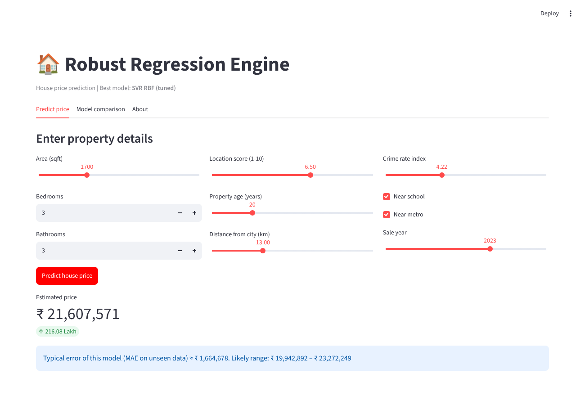

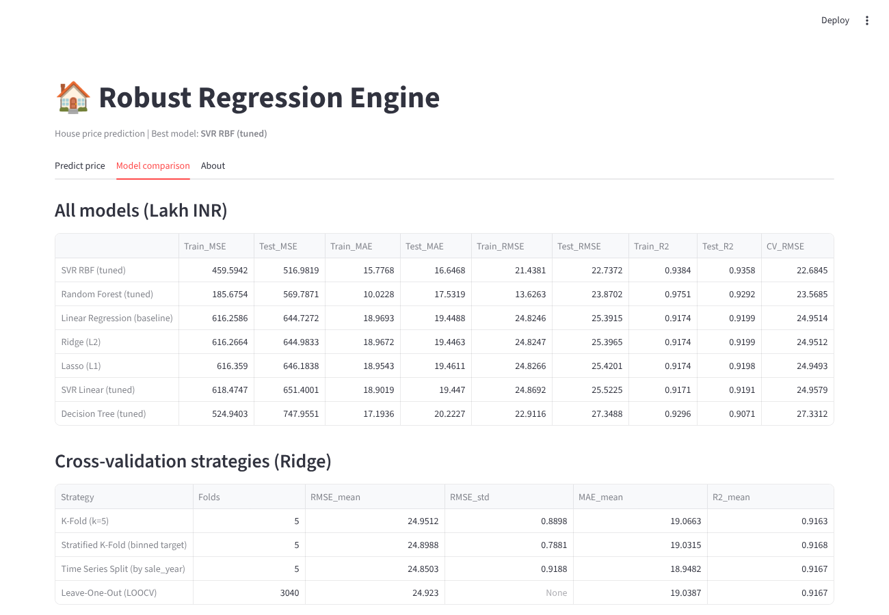

---

## ▶️ Run it yourself

```bash
# 1. clone the repo
git clone <your-repo-url>
cd robust-regression-engine

# 2. install libraries
pip install -r requirements.txt

# 3. open the notebook (Kernel → Restart & Run All)
jupyter notebook Robust_Regression_Engine.ipynb

# 4. start the app
streamlit run app.py
```

## 📁 Files

```
├── Robust_Regression_Engine.ipynb   # full notebook, Part A to H
├── app.py                           # Streamlit app
├── final_model.joblib               # saved best model (SVR RBF)
├── model_meta.json                  # feature ranges + metrics for the app
├── model_comparison.csv             # all model metrics
├── cv_strategies.csv                # CV comparison
├── Robust_Regression_Engine_Theory.pdf
├── requirements.txt
├── Advanced_Regression_HousePrice.xlsx
└── screenshots/                     # output images used in this README
```
